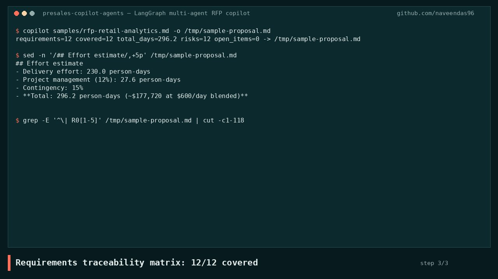
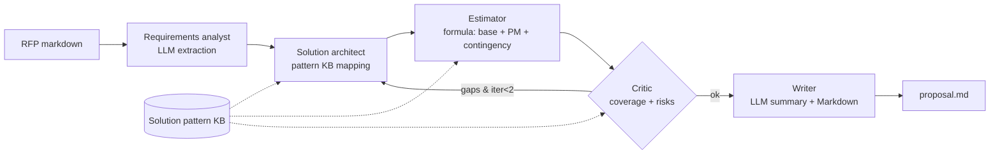

# Presales Copilot: Multi-Agent RFP Response on LangGraph

A team of four agents turns an RFP into a **draft solution proposal**: a requirements traceability matrix, a solution outline, an effort estimate, a risk register and a Markdown export. It's built the way a presales architect actually responds to a bid.

[](docs/demo/demo.mp4)

*Demo recorded from the real CLI output ([MP4](docs/demo/demo.mp4)). More projects: [thenavasoft.com/projects](https://thenavasoft.com/projects.html)*

## Problem
Responding to an RFP takes days of reading, mapping requirements to capabilities, sizing and risk analysis, and the traceability is usually kept by hand in spreadsheets. This copilot does the first 80% in seconds, keeps every number explainable, and flags what still needs a human.

## Architecture


## Key design decisions
- [ADR 0001](docs/adr/0001-langgraph-state-machine.md): a typed LangGraph state machine with a bounded critic loop.
- [ADR 0002](docs/adr/0002-llm-for-language-rules-for-numbers.md): the LLM handles language, deterministic code handles the estimate.
- [ADR 0003](docs/adr/0003-traceability-first.md): the traceability matrix is the core artefact.

## Real output (sample synthetic RFP, mock LLM)
```
$ copilot samples/rfp-retail-analytics.md -o out/sample-proposal.md
requirements=12 covered=12 total_days=296.2 risks=12 open_items=0 -> out/sample-proposal.md
```
| metric | value |
|---|---|
| Requirements extracted | 12 / 12 |
| Must-have coverage | 10 / 10 |
| Delivery effort | 230.0 person-days |
| Total with PM + 15% contingency | 296.2 person-days (~$177,720 at $600/day) |
| Risks identified | 12 |
| Runtime | under 1 s |

The full generated proposal is in [out/sample-proposal.md](out/sample-proposal.md).

## Quickstart
```bash
python3.11 -m venv .venv && . .venv/bin/activate
make install && make test && make demo
LLM_PROVIDER=ollama LLM_MODEL=llama3.2:3b copilot path/to/rfp.md   # real LLM extraction
LLM_PROVIDER=anthropic ANTHROPIC_API_KEY=... copilot path/to/rfp.md
```
Docker: `docker compose run copilot`

## Cost note
The default run costs **$0** (deterministic mock LLM). With a hosted model there are exactly 2 LLM calls per RFP (extraction and summary), so even a 30-page RFP costs a few cents on a Haiku or mini-class model. With local Ollama it's free.

## Limitations
- In mock mode, extraction expects numbered requirements. Free-form RFPs need a real LLM.
- The pattern KB is keyword-matched with 12 patterns. Production would use embeddings and the practice's own delivery history.
- Day rates and contingency are illustrative.
- The output is a draft for an architect to review, not a submission-ready bid.

## License
MIT
